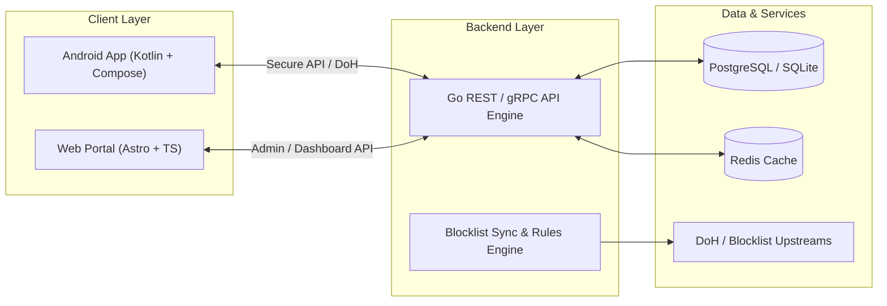

# PGuard 🛡️

> **Shield Your Mind. Reclaim Your Focus.**  
> A cross-platform porn blocker and digital wellbeing ecosystem built with Kotlin, Go, and Astro.

---

[](./mobile)
[](./Backend)
[](./Website)
[](./mobile)
[](LICENSE)

---

## 📌 Overview

**PGuard** is a digital wellbeing platform designed to help users break compulsive habits, eliminate adult content distractions, and build sustainable screentime routines. By combining an on-device Android shield, an ultra-fast Go API service, and a lightweight Astro web portal, PGuard delivers real-time protection, habit tracking, and accountability tooling.

---

## ✨ Key Features

### 🛡️ Content Blocking & Protection
- **Real-Time DNS & URL Filtering:** Intercepts adult, NSFW, and malicious web traffic on-device.
- **Strict SafeSearch Enforcement:** Enforces SafeSearch across Google, Bing, DuckDuckGo, and YouTube.
- **App & Website Blocklists:** Customizable blocking rules with instant locking and scheduled access windows.
- **Tamper Resistance:** Prevents impulsive disabling through pin-locks, delay timers, and device admin protection.

### 📈 Digital Wellbeing & Habit Tracking
- **Streak & Milestone Tracker:** Track recovery milestones, clean streaks, and personal records.
- **Screentime & Trigger Analytics:** Visual breakdown of app usage and high-risk trigger periods.
- **Emergency Panic / SOS Mode:** Quick diversion tools, breathing exercises, and instant focus redirection when cravings hit.

### 🤝 Accountability System
- **Partner Sync:** Notify a trusted accountability partner when settings change or unblock attempts occur.
- **Encrypted Audit Logs:** Secure, privacy-preserving event logs shared only with approved partners.

---

## 🏗️ Architecture & Tech Stack



| Layer | Technology | Key Highlights |
| :--- | :--- | :--- |
| **Mobile App** | **Kotlin**, Jetpack Compose, Coroutines | Native Android app, Material 3 design, local VpnService/Accessibility filtering |
| **Backend API** | **Go (Golang)** | High-throughput, low-latency API, rule engine, auth, and analytics synchronization |
| **Frontend Web** | **Astro**, TypeScript, Tailwind CSS | High-performance landing page, user dashboard, and documentation portal |
| **Storage / Cache** | **PostgreSQL**, **Redis** | Relational user & rule storage, fast in-memory rate-limiting and blocklist caching |

---

## 📁 Repository Structure

```plaintext
PGuard/
├── mobile/                 # Native Android Application (Kotlin)
│   ├── app/                # Main application module
│   │   ├── src/            # Source code (Compose UI, services, logic)
│   │   └── build.gradle.kts# App build configuration
│   ├── gradle/             # Gradle wrapper & version catalog (libs.versions.toml)
│   ├── build.gradle.kts    # Root project build script
│   └── settings.gradle.kts # Project settings
│
├── Backend/                # Core Backend Services (Go)
│   ├── cmd/                # Application entrypoints (api server, workers)
│   ├── internal/           # Business logic, services, domain models
│   ├── pkg/                # Reusable utilities and middleware
│   ├── go.mod              # Go module definition
│   └── go.sum              # Go dependency checksums
│
├── Website/                # Marketing Site & Dashboard (Astro)
│   ├── src/                # Astro components, layouts, and pages
│   ├── public/             # Static assets (favicons, banners)
│   ├── package.json        # Frontend package configuration
│   └── astro.config.mjs    # Astro configuration
│
└── README.md               # Project documentation
```

---

## 🚀 Getting Started

### Prerequisites

Ensure you have the following installed:
- **Android Development:** [Android Studio Ladybug+](https://developer.android.com/studio) with JDK 17+ and Android SDK 34+
- **Backend:** [Go](https://go.dev/dl/) `1.22+`
- **Frontend:** [Node.js](https://nodejs.org/) `18.x` or `20.x+` (and `npm`, `pnpm`, or `bun`)
- **Version Control:** [Git](https://git-scm.com/)

---

### 1. Mobile App Setup (Kotlin / Android)

1. Navigate to the `mobile` directory:
   ```bash
   cd mobile
   ```
2. Build the project using the Gradle wrapper:
   ```bash
   ./gradlew build
   ```
3. Run on a connected Android device or emulator:
   ```bash
   ./gradlew installDebug
   ```
   *Alternatively, open the `mobile/` directory inside Android Studio and hit **Run (Shift + F10)**.*

---

### 2. Backend Setup (Go)

1. Navigate to the `Backend` directory:
   ```bash
   cd Backend
   ```
2. Initialize or verify dependencies:
   ```bash
   go mod tidy
   ```
3. Copy environment variables (if applicable) and start the server:
   ```bash
   # Example starting point
   go run ./cmd/api/main.go
   ```

---

### 3. Frontend Setup (Astro)

1. Navigate to the `Website` directory:
   ```bash
   cd Website
   ```
2. Install dependencies:
   ```bash
   npm install
   # or
   pnpm install
   ```
3. Start the development server:
   ```bash
   npm run dev
   # or
   pnpm dev
   ```
4. Open [http://localhost:4321](http://localhost:4321) in your browser.

---

## 🔒 Privacy & Security Principles

- **Zero Sale of User Data:** We do not monetize personal data or browsing activity.
- **Local-First Processing:** Blocking decisions and telemetry aggregation happen on-device whenever possible.
- **End-to-End Encryption:** Partner communications and audit sync are strictly encrypted in transit and at rest.

---

## 🤝 Contributing

Contributions are welcome! Please follow these steps:

1. **Fork** the repository.
2. Create a feature branch: `git checkout -b feature/amazing-feature`.
3. Commit your changes: `git commit -m 'feat: add amazing feature'`.
4. Push to the branch: `git push origin feature/amazing-feature`.
5. Open a **Pull Request**.

Please ensure your code complies with linting standards and tests pass before submitting.

---

## 📄 License

This project is licensed under the [MIT License](LICENSE) - see the LICENSE file for details.

---

<p align="center">
  Built with ❤️ for a focused, healthier digital life.
</p>
